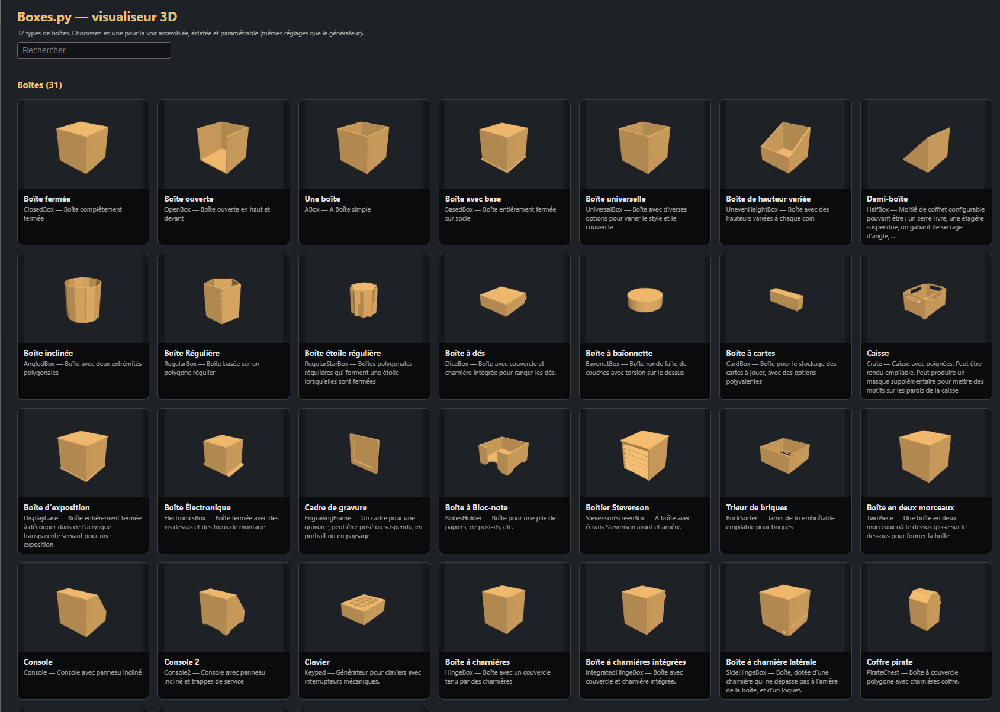
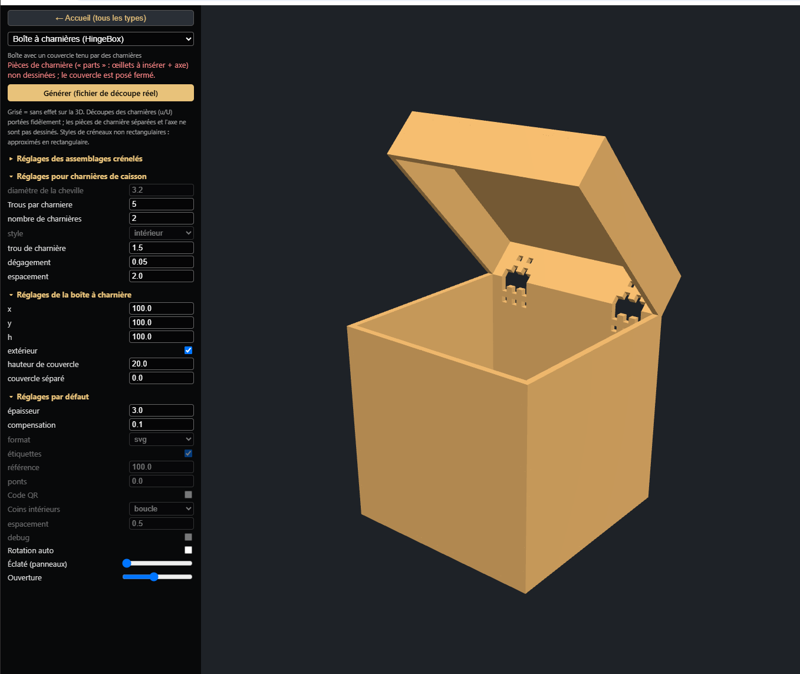
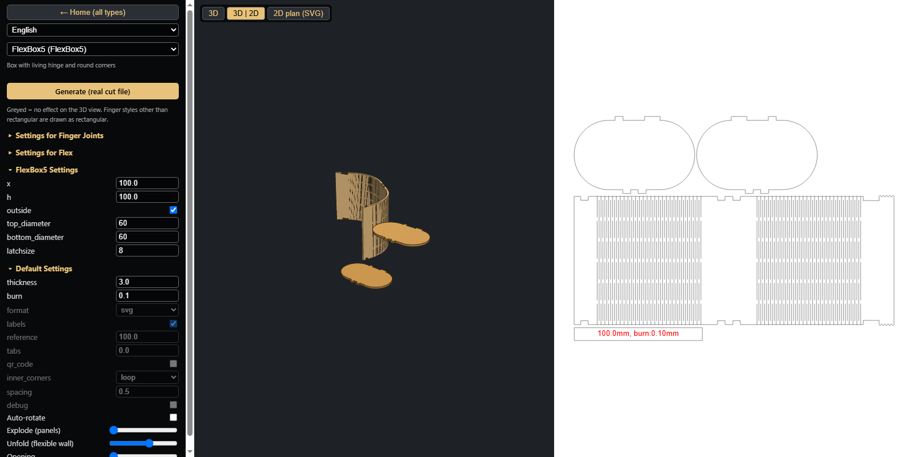
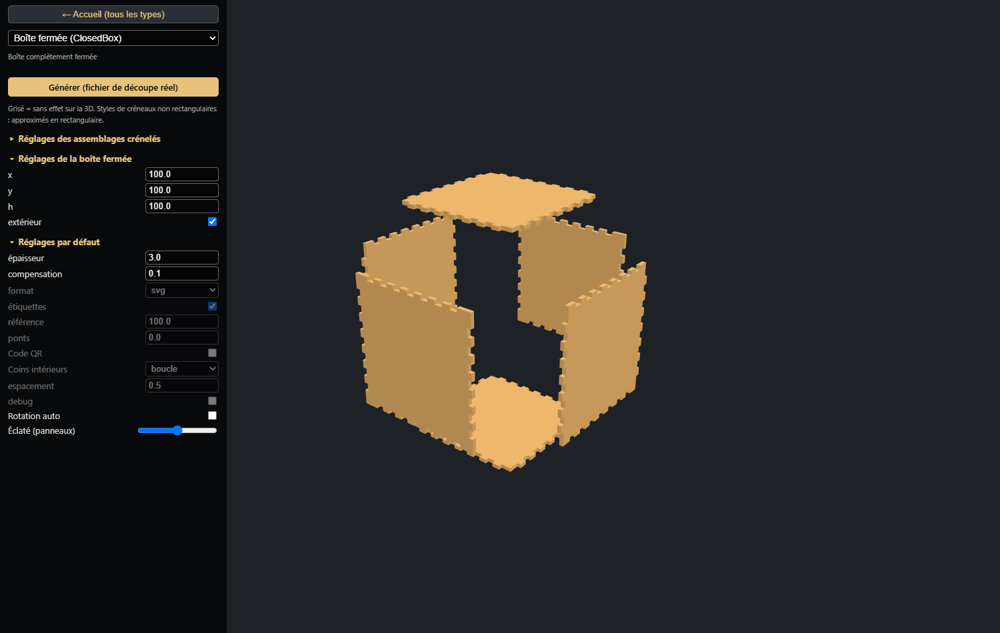
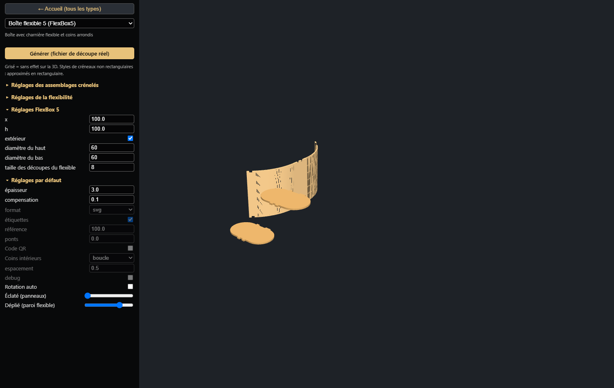
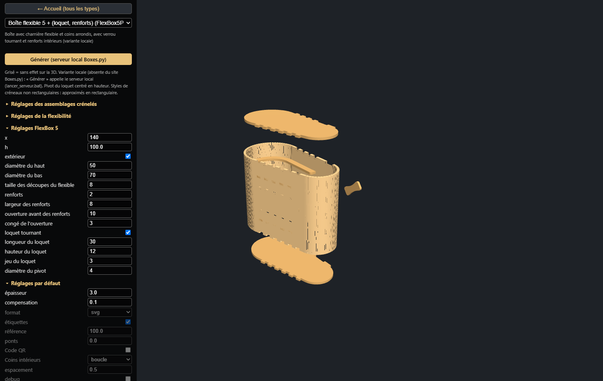
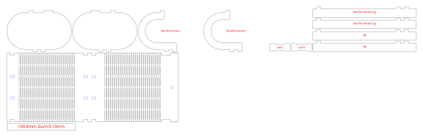

# Boxes.py – 3D Visualizer

*A modernized front end for [Boxes.py](https://github.com/florianfesti/boxes) with a live 3D preview.*

One self-contained HTML page that lets you browse the Boxes.py generators, change their parameters and **see the assembled box in 3D** — finger joints, holes, living-hinge cuts, lids and hinges included — before you cut anything. Parts can be exploded, flexible walls unrolled, and lids / drawers / latches opened.





## Contents

- [Features](#features)
- [Getting started](#getting-started)
- [Deep links](#deep-links)
- [Supported generators](#supported-generators)
- [FlexBox5Plus: reinforcements and turning latch](#flexbox5plus-reinforcements-and-turning-latch)
- [How it works](#how-it-works)
- [Limitations](#limitations)
- [TODO](#todo)
- [Credits and license](#credits-and-license)

## Features

**Browsing**
- Home page with a rendered 3D thumbnail for every generator, a live search box and two sections (*Boxes*, *Boxes with a flexible hinge*).
- Thumbnails are rendered in your browser on first load (a few seconds) and cached in `localStorage`, so the next visit is instant.
- A selector at the top of the side panel switches generator without going back to the home page.

**Same parameters as the real generator**
- Every generator exposes the **same parameters, labels, defaults and choices as the official Boxes.py web form** (they were extracted from it, not retyped). Hover a label to get the original help text.
- Parameters that only matter for the cut file (format, labels, QR code, spacing, …) are **greyed out**: they have no effect on the 3D model.
- Groups of parameters are collapsible; *finger joint* and *flex* settings start collapsed.
- Dimensions follow the generator's own rules, including the *outside* switch (outer vs. inner size) and the per-edge size corrections.
- Invalid combinations show the same kind of error as the generator instead of drawing garbage; anything that is approximated is flagged in red under the title.

**3D view**
- Real part outlines extruded to the material thickness: finger joints and notches, finger holes (`h` edges), living-hinge slits, latch notches, rounded corners, handle and magnet holes, hinge knuckles…
- Every panel has a slightly different shade and a dark outline, so individual pieces and their finger joints stay readable even when the box is assembled; cut-outs in the flexible wall (notches, slits, holes) are outlined too.
- Orbit / zoom / pan with the mouse, optional auto-rotation, and a short *assembly* animation (exploded → assembled) each time you pick a generator.
- **View modes** (buttons above the 3D view): **3D**, **Plan 2D (SVG)** or **3D | 2D** side by side. The 2D plan is the real cut file produced by the generator for the current parameters (public Boxes.py instance, or the local server for *FlexBox5Plus*); it follows the parameters as you edit them. Mouse wheel zooms, drag pans, double-click fits.

**Sliders**
- **Explode** – moves every panel away from the box along its outward normal, so joints and holes are visible.
- **Unfold** (flexible-wall boxes) – flattens the living-hinge wall step by step and lays the plates beside it, like on the cutting plan.
- **Opening** (boxes that really open) – rotates or slides the moving parts about / along the real axis: lids on hinges, sliding lids and drawers, twist-lock bayonet, removable panels. On **flexible-wall boxes** the opening is sequenced: the turning latch (FlexBox5Plus) first turns from vertical (locked) to 90° (free) over the first 40 % of the slider, then the flexible part at the front of the box (the last arc before the latch) unfolds and the free end swings out with the latch.

**Cut file**
- The **Generate** button opens the genuine cut plan (SVG, PDF, DXF…) on the public Boxes.py instance with exactly the parameters you set.
- For the local variant *FlexBox5Plus* it calls a small local server that runs the generator on your machine (see below).

## Getting started

1. Open `boxes.py-3dviz.html` in a recent desktop browser (WebGL required). There is no build step and nothing to install.
2. Pick a box on the home page, tweak the parameters, drag the sliders.

Notes
- The page loads [three.js](https://threejs.org/) r128 and its `OrbitControls` from public CDNs (cdnjs, jsDelivr), so it needs an internet connection the first time (see the [TODO](#todo)).
- Opening the file straight from disk (`file://`) works. Some browsers block `fetch` to `localhost` from `file://` pages; the local-server button simply opens a new tab, so this is not an issue in practice.

## Deep links

The URL hash selects a generator and, optionally, the view state and parameters:

```
boxes.py-3dviz.html#<Generator>[&mode=3d|2d|split][&explode=<mm>][&unfold=<0..1>][&open=<0..1>][&view=iso|top|front|side][&rotate=0][&ui=0][&p_<parameter>=<value>]...
```

| Option | Meaning |
|---|---|
| `mode=split` | view mode: `3d`, `2d` (SVG plan only) or `split` (3D and plan side by side) |
| `explode=40` | explode slider (0–80 mm) |
| `unfold=1` | unfold slider (flexible-wall boxes) |
| `open=0.7` | opening slider (boxes that open) |
| `view=top` | camera direction (`iso`, `top`, `front`, `side`) |
| `rotate=0` | no auto-rotation |
| `ui=0` | hide the side panel |
| `p_x=120`, `p_outside=0` | any form parameter by its Boxes.py name (checkboxes take `0`/`1`) |

Without `explode` / `unfold` / `open` the assembly animation plays on load. Examples:

```
boxes.py-3dviz.html#ClosedBox&explode=40&rotate=0
boxes.py-3dviz.html#HingeBox&open=0.7&p_h=150
boxes.py-3dviz.html#FlexBox5&unfold=0.75&view=iso
```

The screenshots below (and the FlexBox5Plus ones further down) were produced from such links with a headless browser.







## Supported generators

36 of the 183 official generators, plus one local variant (37 entries). The list is also what the home page shows.

| Group | Generators |
|---|---|
| Plain boxes | `ClosedBox`, `OpenBox`, `ABox`, `BasedBox`, `UniversalBox`, `UnevenHeightBox`, `HalfBox`, `AngledBox`, `Crate`, `TwoPiece`, `DisplayCase`, `ElectronicsBox`, `EngravingFrame`, `NotesHolder`, `StevensonScreenBox`, `BrickSorter`, `CardBox`, `Keypad`, `Console`, `Console2` |
| Round / polygonal | `RegularBox`, `RegularStarBox`, `BayonetBox`, `DiceBox` |
| Hinges, drawers, sliding parts | `HingeBox`, `IntegratedHingeBox`, `SideHingeBox`, `PirateChest`, `SlidingDrawer`, `SlidingLidBox`, `SideDoorHousing` |
| Living hinge (flex) | `FlexBox`, `FlexBox2`, `FlexBox4`, `FlexBox5`, `ShutterBox` |
| Local variant | `FlexBox5Plus` (see below) |

Boxes with an **Opening** slider: `BayonetBox`, `CardBox`, `Console2`, `DiceBox`, `HingeBox`, `IntegratedHingeBox`, `PirateChest`, `SideHingeBox`, `SlidingDrawer`, `SlidingLidBox`, `TwoPiece`, `FlexBox5Plus`.
Boxes with an **Unfold** slider: `FlexBox`, `FlexBox2`, `FlexBox4`, `FlexBox5`, `FlexBox5Plus`.

The [missing generators](#missing-generators) are listed in the TODO.

## FlexBox5Plus: reinforcements and turning latch

`FlexBox5Plus` is **not** part of upstream Boxes.py. It is `FlexBox5` plus two options, implemented both in this viewer and as a Boxes.py generator (`flexbox5plus.py`) that produces the real cut plan:



- **Reinforcements** (`reinforcements`, `reinforcement_width`, `reinforcement_open`, `reinforcement_fillet`): *N* evenly spaced inner frames. A reinforcement is the side plate, hollowed out to a band of the chosen width, with the same finger joints; the flexible wall gets matching finger holes at each frame's height. The frame is **open on the latch side** (the side of the box that opens): the cut is aligned on a finger at both ends and the inner corners get a small fillet.
- **Turning latch** (`turn_latch`, `latch_width`, `latch_height`, `latch_margin`, `latch_hole`): two "butterfly" (bone-shaped) pieces glued on both sides of the closing tab of the flexible wall, pivoting on a round hole of the tab. The hole sits close to the end of the tab (`latch_height/2 + latch_margin`) and vertically centred.

- **Unfolding jig** (`flex_jig`, `flex_unfold_auto`, `flex_unfold_adjust`, `flex_jig_height`): lets you glue paper or fabric on the flexible wall *while it is held stretched*, so the glued wall keeps the right length and the box closes without forcing the slits. The generator cuts two **combs** carrying the same fingers as the wall, but spaced by the *unfolded* length of the flexible zone: fit the notches of the wall edge onto the teeth, glue the paper/fabric on the face that will be the outside of the box, let it dry. The stretch of each flexible zone is estimated as `t / r` (thickness over the radius of the arc: the outer face is longer than the inner one by that ratio, e.g. 11 % for a 3 mm wall on a 27 mm radius); `flex_unfold_adjust` adds or removes percentage points on top (negative = less unfolded), and `flex_unfold_auto=0` drops the estimate so only the adjustment applies. With reinforcements, one extra **reinforcement comb** per frame is cut: its teeth sit at the unfolded positions of the reinforcement holes (only the fingers kept by the opening), so it can be passed through those holes at the height of each frame to hold the wall stretched there too. The viewer shows the estimate in red under the title and draws the combs next to the bottom plate.

> The `Flex_stretch` ("étirement") setting of the Boxes.py form has **no effect on FlexBox5** (nor on FlexBox, FlexBox2/3/4): upstream only uses it in `surroundingWall` (rounded boxes) and `Shoe`. That is why changing it changes nothing; use the unfolding parameters above instead.



### Producing the cut plan locally

The cut plan of this variant cannot come from the public Boxes.py site, so the **Generate** button talks to a tiny local server:

1. Install Boxes.py (a checkout is enough) and its Python dependencies (`affine`, `markdown`, `numpy`, `pillow`, `PyYAML`, `qrcode`, `rectpack`, `shapely`, `svgpathtools`, `typing_extensions`).
2. Copy `companion/flexbox5plus.py` into `boxes/generators/` of that checkout.
3. Run `python companion/boxes_local_server.py` or `companion/start_server.bat` (it looks for Boxes.py next to itself, in `BOXES_SRC`, or in a temp install) and keep it running. It listens on `127.0.0.1:8777` only.
4. Click **Generate**: the plan opens in a new tab. The generator is reloaded on each request, so you can edit `flexbox5plus.py` without restarting.

The same server answers for any Boxes.py generator (`http://127.0.0.1:8777/<Generator>?<parameters>`), which is handy to compare the 3D model with the real output.

> `flexbox5plus.py`, `boxes_local_server.py` and `start_server.bat` live in [`companion/`](companion/).

## How it works

- **Parameter schemas** – a script reads each generator's web form and stores labels, defaults, choices and help texts as JSON embedded in the page.
- **Geometry** – the geometry of each generator is a JavaScript port of its Python `render()`: a Boxes.py-style *turtle* draws edges (`e` plain, `f` fingers, `F` notches, `h` plain + finger holes, hinge / latch / groove edges…), the finger layout (`calcFingers`) and the width / margin rules of `rectangularWall`, `trapezoidWall` and friends are reproduced, so that mating panels line up exactly.
- **Panels** – each part is a 2D outline (with holes) extruded to the material thickness and placed in a box-centred coordinate system; panels know their outward direction for the *Explode* slider.
- **Flexible walls** – the wall is wrapped along the side-plate outline as a ribbon whose texture is cut with alpha (finger notches, flex slits, holes). The *Unfold* slider reduces the curvature of the path until it is flat.
- **Opening** – a generator may declare *openers* (rotation about an axis or sliding along a vector) for sets of panels.
- **Single file** – everything is generated into one HTML file; only three.js comes from a CDN.

The page is generated from sources in `src/` (everything in English):

```
src/template.html        page, engine, built-in generators, i18n core
src/modules/*.js         one module per additional generator
src/generators.json      generators in display order
src/i18n/                schemas.json (parameter structure), texts.json (labels / help per language),
                         ui.<lang>.json and modules/<lang>_<Module>.json (message translations)
tools/extract_schemas.py scrapes the forms of the public Boxes.py site (all languages)
tools/build.py           python tools/build.py  ->  boxes.py-3dviz.html
tools/check_messages.py  lists messages that lack a translation (python tools/check_messages.py fr de)
companion/               flexbox5plus.py, local server, start_server.bat
```

## Localization

Parameter labels, help texts and group names come from the Boxes.py web form in each language (`de`, `en`, `es`, `fr`, `pt_BR`, `zh_CN`); the interface and the generator messages are written in English and translated through dictionaries. The language is taken from the browser (`navigator.languages`, first supported match), falls back to English, can be changed with the selector (top of the page / side panel), is remembered in `localStorage`, and can be forced with `lang=<code>` in the URL hash. Messages missing from a language fall back to English.

## Limitations

- **Not validated against the cut files.** Geometry comes from reading the Python generators and was checked visually and with overlap tests, not by diffing against real SVG output. Panel *placement* in the assembly is sometimes **deduced** (the generators only produce flat parts); such cases are flagged in the UI.
- **Finger style**: only `rectangular` is modelled; `springs`, `barbs` and `snap` are drawn as rectangular fingers.
- **Angled joints** (angles ≠ 90°: `AngledBox`, `Console`, `RegularBox`, `PirateChest` lid, `ShutterBox`) are drawn as flat-cut plates without the mitre, so small gaps or overlaps can show at the corners; on `RegularBox` with 5 or more sides about 0.1–0.3 % of the volume overlaps.
- **Hardware is not drawn**: hinge pins and loose hinge parts, latches and clamps, magnets, screws, the back support of `EngravingFrame`, the base plate and brackets of `StevensonScreenBox`, bed-bolt slots, text and labels.
- **Partial generators**: `Console2` (no hardware), `SideDoorHousing` (no latches), `CardBox` (dividers lightly checked), `Keypad` (screw holes, plate stacking deduced), `SideHingeBox` (no latches), `HingeBox` (hinge axis position deduced), `BayonetBox` (layer order deduced, no lift after unlocking), `ShutterBox` (door, rails and corner pieces placed by deduction; no opening animation because the door is a flexible strip), `UniversalBox` and `BasedBox` (only top edges `e`, `f`, `F`, `h`; no "top hole" panel), `UnevenHeightBox` (no lid, no grooves), `FlexBox` (first section only, no dividers), `FlexBox2` / `FlexBox4` (wall end fingers not drawn), `HalfBox` (mounting edge drawn plain), `NotesHolder` (`opening = 0` raises an error, as the generator does).
- **Parts are drawn closed**: most generators have no meaningful "open" state; lids sit closed unless the *Opening* slider exists. Edge *thickness* of the flexible wall is not shown on cut-outs.
- **Sliders are visual aids**: *Explode* moves panels along fixed directions, *Unfold* is a smooth approximation of the real unrolling (the plates are simply laid beside the wall).
- **Translations**: generator notes and warnings are translated to French only; the other languages fall back to English (see the [TODO](#todo)).
- Needs WebGL and, for now, internet access for the three.js CDN. Layout is designed for a desktop screen.
- The local server is unauthenticated and bound to `127.0.0.1`; do not expose it.

## TODO

### Localization
- Translate the per-generator notes and warnings (`src/i18n/modules/<lang>_<Module>.json`) into `de`, `es`, `pt_BR`, `zh_CN` (only `fr` is complete; `python tools/check_messages.py de` lists what is missing).
- Add more languages (the public Boxes.py form only offers the six above) and translate the plan labels of `flexbox5plus.py`.

### Missing generators
Boxes.py offers 183 generators; 36 are covered. The remaining 147, by category of the public site:

- **Boxes (6)** – `Coffin`, `EuroRackSkiff`, `Rack10Box`, `Rack19Box`, `Rack19HalfWidth`, `RackBox`
- **Boxes with flex (9)** – `BreadBox`, `DoubleFlexDoorBox`, `FlexBook`, `FlexBox3`, `HeartBox`, `RoundedBox`, `RoundedRegularBox`, `RoundedTrapezoidBox`, `UBox`
- **Trays and drawer inserts (14)** – `CompartmentBox`, `DividerTray`, `DrillBox`, `GridfinityBase`, `GridfinityDrillBox`, `GridfinityTrayLayout`, `HobbyCase`, `PenHolderBox`, `SlantedTray`, `SmallPartsTray`, `SmallPartsTray2`, `TrayInsert`, `TrayLayout`, `TypeTray`
- **Shelves (11)** – `BinTray`, `CardHolder`, `DiscRack`, `DisplayShelf`, `PaintStorage`, `SBCMicroRack`, `SpicesRack`, `StackableBin`, `StorageRack`, `StorageShelf`, `WineRack`
- **Wall mounted (22)** – `DinRailBox`, `KeyHolder`, `RollHolder`, `SkadisBoard`, `SkadisStand`, `WallCaliper`, `WallChiselHolder`, `WallConsole`, `WallDrillBox`, `WallEdges`, `WallHook`, `WallHopper`, `WallPinRow`, `WallPlaneHolder`, `WallPliersHolder`, `WallRack`, `WallRollHolder`, `WallSlottedHolder`, `WallStackableBin`, `WallStairs`, `WallTypeTray`, `WallWrenchHolder`
- **Hole patterns (5)** – `FanHole`, `FrontPanel`, `HolePattern`, `NemaPattern`, `SevenSegmentPattern`
- **Parts and samples (18)** – `BurnTest`, `ConcaveKnob`, `FillTest`, `FlexTest`, `FlexTest2`, `GearBox`, `Gears`, `LBeam`, `LaserHoldfast`, `Linkage`, `NemaMount`, `Planetary`, `Pulley`, `RectangularWall`, `RobotArm`, `TriangularWall`, `WavyKnob`, `ZBeam`
- **Misc (56)** – `AgricolaInsert`, `AirPurifier`, `AllEdges`, `AngledCutJig`, `Arcade`, `Atreus21`, `BeeQueenCage`, `BeeQueenTransportBox`, `BirdHouse`, `BookHolder`, `BottleStack`, `BottleTag`, `CanStorage`, `CarbonFilter`, `Clock`, `CoffeeCapsuleHolder`, `CoinBankSafe`, `CoinDisplay`, `Desksign`, `DiceTower`, `Dispenser`, `Display`, `DrillGauge`, `DrillStand`, `FatBallDispenser`, `FilamentSpool`, `Folder`, `FrameLoom`, `Hook`, `JointPanel`, `Kamishibai`, `LaptopStand`, `LaserClamp`, `MagazineFile`, `MakitaPowerSupply`, `Matrix`, `NightLightBox`, `OttoBody`, `OttoLegs`, `OttoSoles`, `PaperBox`, `PhoneHolder`, `PhotoFrame`, `PizzaShovel`, `PoleHook`, `Ramp`, `RoyalGame`, `SevenSegmentClock`, `Shadowbox`, `Shoe`, `Sphere`, `Spool`, `Stachel`, `Tetris`, `TrafficLight`, `TriangleLamp`
- **Unstable (6)** – `Castle`, `OrganPipe`, `Planetary2`, `Platonic`, `Rotary`, `Silverware`

Good next candidates: `TypeTray` and the other tray / divider generators (compartment layouts), the rest of the flex family (`FlexBox3`, `RoundedBox`, `UBox`, `DoubleFlexDoorBox`…), and the rack boxes. Flat "parts and samples" and "hole patterns" generators have no assembly to show and could simply render as 2D plates.

### Other
- **Validation**: automatic comparison of every 3D panel outline with the real generator output (run Boxes.py locally, overlay the SVG on the viewer's outlines, report differences) and a regression suite built on it.
- **Fidelity**: non-rectangular finger styles; mitred angled joints; hinge, latch and clamp hardware; the remaining top edges of `UniversalBox` / `BasedBox` (lids, hinges, sliding lids, stackable edges…); dividers and multiple sections for `FlexBox` and the tray family.
- **Offline use**: bundle three.js and `OrbitControls` locally instead of loading them from CDNs.
- **License notices**: add a short GPL-3.0 header to the generated HTML and to the Python companion files.
- **Export**: download the current view as PNG, and the model as STL / GLB / OBJ; show a 2D "sheet" preview next to the 3D view.
- **UX**: keep the URL in sync with the current parameters and sliders (shareable state), mobile / touch layout, light theme, keyboard accessibility, measurement tool, per-panel highlight and part list, an "assembly order" step-through.
- **Performance**: avoid rebuilding large wall textures on every keystroke; render thumbnails in a worker or pre-generate them.
- **Tests / CI**: smoke test that builds every generator with its defaults and with random valid parameters.

## Credits and license

- [Boxes.py](https://github.com/florianfesti/boxes) by Florian Festi and contributors – generators, edges and the web form this viewer mirrors. The public instance used for cut plans is hosted by the [Hackerspace Bamberg](https://boxes.hackerspace-bamberg.de/).
- 3D rendering by [three.js](https://threejs.org/).
- Licensed under the **GNU General Public License v3.0**, like Boxes.py from which the generator geometry is ported (see [LICENSE](LICENSE)).
